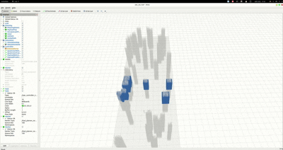

# DualTrans: Whole-Body Motion Planning for Dual-UAV Transportation of a Rigid Rod


## Setup

Compiling tests passed on Ubuntu 20.04/18.04 with ROS installed.
### Prerequisites
- [ROS](http://wiki.ros.org/ROS/Installation) (tested with Noetic)
  
```bash
sudo apt install ros-"${ROS_DISTRO}"-mavros-msgs
```

### Compiling and Running
```bash
# Compile the code
git clone https://github.com/xxx/dultrans
cd ..
catkin_make 

# Run the simulation with planner and controller
source devel/setup.bash
roslaunch dual_planner simple_run.launch
```

### How to Use 
You should see the simulation in rviz. You can use the `2D Nav Goal` to set the goal position.




## Maintaince
For any technical issues, please contact xxx.